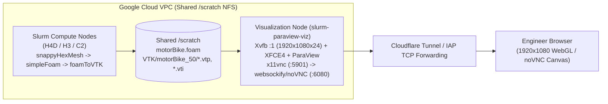

# ParaView Remote CFD Visualization & High-FPS Animation Guide

This guide documents production patterns, architecture, and performance optimizations for running **ParaView 5.10+** interactively and headlessly (`pvpython`) on Google Cloud HPC / Slurm clusters to visualize OpenFOAM and CAE simulations.

--------------------------------------------------------------------------------

## 1. Cloud Remote Visualization Architecture (`slurm-paraview-viz`)

For interactive 3D post-processing without requiring users to download multi-gigabyte OpenFOAM or VTK datasets over WAN:



### Key Stack Components
1. **Virtual X11 Framebuffer**: `Xvfb :1 -screen 0 1920x1080x24 +iglx` with `xfce4-session` provides a crisp 1080p desktop on CPU-only (`n2-standard-8` / `c4-standard-16`) or GPU (`g2-standard-8` L4) nodes.
2. **VNC + WebSockets Bridge**: `x11vnc -display :1 -forever -shared -nopw -rfbport 5901` paired with `websockify --web=/usr/share/novnc/ 6080 localhost:5901` exposes `/vnc.html?autoconnect=true&resize=remote`.
3. **Pre-Baked Binary VTK Assets**: Pre-computing decimated `.vtp` (PolyData) and structured `.vti` (ImageData) caches on `/scratch` enables **17+ FPS real-time animation** even on CPU-only Mesa LLVMpipe software OpenGL.

--------------------------------------------------------------------------------

## 2. Four Standard External Aerodynamics Visualizations (`motorBike`)

Generated automatically by [`scripts/paraview_cae_visualizer.py`](scripts/paraview_cae_visualizer.py) and installed into `~/.config/ParaView/Macros/`:

| Macro Button | Engineering Purpose | VTK Pipeline Architecture | Animation Mechanism |
| :--- | :--- | :--- | :--- |
| **`1_3D_StreamTubes`** | 3D Aerodynamic Streamlines, Stagnation Pressure & Flow Particles | `motorbike_surface_fast.vtp` (colored by `p`, Diverging Cool-to-Warm) + `tubes1_fast.vtp` & `tubes2_fast.vtp` (colored by `|U|`, Turbo) + `Contour(IntegrationTime)` -> `Glyph(Sphere)` | `PythonAnimationCue` advances 6 iso-time wavefronts along `IntegrationTime` (`17.3 FPS`, `0.58s` loop) |
| **`2_Velocity_Slice`** | Symmetry Plane ($Y=0$) Boundary-Layer Separation & Sweeping Cross-Plane | `nearfield_structured.vti` -> `Slice(Y=0.001)` + `Glyph(Arrow, Stride=16)` + `Slice(X=var)` | `PythonAnimationCue` sweeps the $X$-normal cross-plane from front wheel ($X=-0.4\text{ m}$) through far wake ($X=3.8\text{ m}$) (`16.2 FPS`) |
| **`3_Wake_Turbulence`** | 3D Vortex-Shedding Iso-Surfaces of Turbulent Kinetic Energy ($k$) | `tke_iso_fast.vtp` ($k \in \{2.2, 5.0, 10.0\}\text{ m}^2/\text{s}^2$, colored by `|U|`) + horizontal ground wake `Slice(Z=var)` | `PythonAnimationCue` sweeps the horizontal wake plane vertically ($Z = 0.06 \to 1.31\text{ m}$) while orbiting the camera (`17.2 FPS`) |
| **`4_Quad_Dashboard`** | 2x2 Synchronized Multi-Viewport Engineering Dashboard | `SplitHorizontal` + `SplitVertical` combining 3D StreamTubes + Particles, 2D Centerline Vector Slice, 3D TKE Iso-Surfaces, and 3D Sweeping Wake Slice | Single `PythonAnimationCue` drives both the 3D flow particles in View 1 and the sweeping cross-plane in View 4 (`6.0 FPS` across 4 simultaneous 3D views) |

--------------------------------------------------------------------------------

## 3. Eight Critical Pitfalls & Performance Optimizations

### Pitfall 1: Slow VCR `Play` Button Animation (~1 FPS) & `Time: 0` Resets
- **Symptom**: Clicking the VCR **Play** button in ParaView takes `>1.0s` per frame (~36 seconds per loop) and resets the motorbike surface pressure coloration (`p = 0`) at Frame 0.
- **Root Causes**:
  1. `OpenFOAMReader` registers `TimestepValues = [0.0, 50.0]` with ParaView's `TimeKeeper`. Because `TimeAnimationCue` is enabled by default, clicking **Play** jumps back to `t = 0` at Frame 0 (re-reading `0/` from disk where $p=0$) and reloads `50/` mid-animation.
  2. Re-evaluating 3D filters (`Contour`, `Slice`, `Glyph`) on the 353,000-cell polyhedral mesh (`internal.vtu`) on every frame forces CPU triangulation and OpenGL VBO re-uploads.
  3. High-poly 12-sided streamtubes (350k+ triangles) and translucent surfaces (`Opacity < 1.0`, which triggers multi-pass depth peeling) bottleneck Mesa LLVMpipe software rasterization.
- **Solution (17x–60x Speedup)**:
  1. Load the $t=50$ motorbike surface from a pre-baked static `.vtp` file (`XMLPolyDataReader`, which has no timesteps) and explicitly disable `TimeAnimationCue`:
     ```python
     try:
       GetTimeTrack().Enabled = 0
     except Exception:
       pass
```
  2. Pre-bake decimated `.vtp` streamtubes (`NumberofSides=6`, `Decimate(TargetReduction=0.70)`), low-resolution sphere glyphs (`ThetaResolution=6, PhiResolution=6`), and structured `.vti` near-field volume (`nearfield_structured.vti`).
  3. Set `scene.NumberOfFrames = 10` (or `12`) in `Sequence` mode so each tick advances 3.5x farther spatially.
  4. Provide the **`6_Turbo_Speed`** macro (or use `View -> Animation View` -> `No. Frames` / `Mode: Real Time`) to toggle between `6` frames (~0.35s ultra-fast loop) and `12` frames (~0.7s smooth loop).

### Pitfall 2: ParaView 5.10 `SaveData` Raw Appended XML Parser Error
- **Symptom**: `vtkXMLDataParser: Error parsing XML in stream: not well-formed (invalid token)` when reading `.vtp` or `.vti` files created by `SaveData()`.
- **Root Cause**: ParaView 5.10 defaults to unencoded raw binary in the `<AppendedData>` XML block, which breaks `vtkXMLPolyDataReader` on certain buffer boundaries.
- **Solution**: Always pass `DataMode="Binary"` (Base64-encoded binary XML):
  ```python
  SaveData(output_path, proxy=source_proxy, DataMode="Binary")
```

### Pitfall 3: `CellDatatoPointData` Casing & Preserving Pressure `p` Across `Decimate`
- **Symptom**: `NameError: name 'CellDataToPointData' is not defined` or `WARN| Could not determine array range` after running `Decimate`.
- **Root Cause**:
  1. In `paraview.simple`, the filter is spelled `CellDatatoPointData` (lowercase `to`).
  2. `vtkDecimatePro` drops `CellData` arrays (`p`) unless converted to `PointData` before triangulation and decimation.
- **Solution**:
  ```python
  c2p = CellDatatoPointData(Input=surf)
  tri = Triangulate(Input=c2p)
  dec = Decimate(Input=tri, TargetReduction=0.65, PreserveTopology=1)
```
  Then color by `('POINTS', 'p')` instead of `('CELLS', 'p')`.

### Pitfall 4: ParaView 5.10 Qt GUI Segfault on `KeyFrameAnimationCue` for `Contour.Isosurfaces`
- **Symptom**: ParaView GUI crashes (`SIGSEGV` in `pqAnimationViewWidget::onSceneCuesChanged()` inside `libpqComponents-pv5.10.so.1`) when attaching `KeyFrameAnimationCue` (`GetAnimationTrack`) to `Contour.Isosurfaces`.
- **Solution**: Always use `PythonAnimationCue` with a `tick(self)` function to update `Contour.Isosurfaces` or `Slice.SliceType.Origin` dynamically.

### Pitfall 5: `OpenFOAMReader` Internal Mesh Obscuring Surface Geometry
- **Symptom**: Selecting both `internalMesh` and `motorBike_*` patches on a single `OpenFOAMReader` renders the outer wind-tunnel box opaque, hiding the motorbike.
- **Solution**: Query `bike.UpdatePipelineInformation()` first, then filter `bike.MeshRegions = [r for r in bike.MeshRegions.Available if "motorBike" in r]`, and load the internal flow volume separately.

### Pitfall 6: `StreamTracer` Backward Integration Shrinking the Viewport
- **Symptom**: Using `IntegrationDirection = "BOTH"` on seeds near $X = -0.45\text{ m}$ traces streamlines backward to the inlet at $X = -5.0\text{ m}$, making the bounding box 3x wider and shrinking the motorbike.
- **Solution**: Always set `IntegrationDirection = "FORWARD"` and `MaximumStreamlineLength = 4.2` with seeds placed just upstream of the front tire ($X \in [-0.50, -0.45]\text{ m}$).

### Pitfall 7: Polyhedral Cell Warnings (`vtkTableBasedClipDataSet` Cell Type 42)
- **Symptom**: Running `Clip` or `Contour` directly on `snappyHexMesh` unstructured grids (`internal.vtu`) floods stderr with `Unsupported cell type(42)` warnings and runs slowly.
- **Solution**: Resample the near-field bounding box (`[-0.8, 4.5, -1.2, 1.2, 0.02, 2.2]`) once via `ResampleToImage(SamplingDimensions=[130, 65, 65])` and save to `nearfield_structured.vti`.

### Pitfall 8: Permanently Suppressing `"Welcome to ParaView"` Modal Dialog
- **Symptom**: Modal `"Welcome to ParaView"` dialog blocks automated screenshots and macro clicks on startup.
- **Solution**: Qt5 `QSettings` in ParaView 5.10 checks `GeneralSettings.ShowWelcomeDialog=false` (with a literal dot in the key name) under `[General]` in `~/.config/ParaView/ParaView5.10.0.ini`:
  ```ini
  [General]
  GeneralSettings.ShowWelcomeDialog=false
  ```
