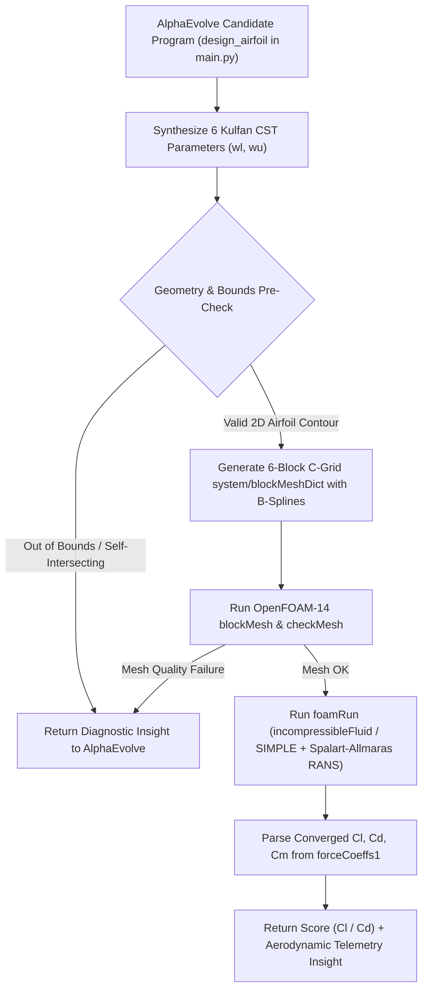

# 2D Airfoil Optimization with OpenFOAM-14 (`airFoil2D`)

This example uses AlphaEvolve to evolve a 2D airfoil geometry generator in Python (`design_airfoil` in `main.py`) that synthesizes the optimal 6 Kulfan Class-Shape Transformation (CST) parameters to maximize the aerodynamic lift-to-drag ratio (`Cl / Cd`), evaluated directly via **OpenFOAM-14 steady-state incompressible RANS CFD simulations** (`tutorials/incompressibleFluid/airFoil2D`).

---

## Architecture & Evaluation Pipeline

Each candidate program generated by AlphaEvolve is evaluated by running **1 full OpenFOAM-14 simulation** in an isolated Cloud Batch container:



---

## Mathematical & Aerodynamic Formulation

### 1. Kulfan Class-Shape Transformation (CST)
The upper and lower airfoil surfaces $y_u(x), y_l(x)$ are parameterized over normalized chord $x \in [0, 1]$ as:

$$y(x) = C(x) \cdot S(x), \quad C(x) = \sqrt{x}\,(1 - x)$$

$$S(x) = \sum_{j=0}^{2} w_j \binom{2}{j} x^j (1 - x)^{2 - j}$$

where:
- $x[0:3] = [w_{l,0}, w_{l,1}, w_{l,2}]$ are the **lower-surface** Bernstein weights (negative, bounded in `[-0.3, -0.1]`, `[-0.3, -0.05]`, `[-0.3, -0.05]`).
- $x[3:6] = [w_{u,0}, w_{u,1}, w_{u,2}]$ are the **upper-surface** Bernstein weights (positive, bounded in `[0.1, 0.3]`, `[0.05, 0.3]`, `[0.05, 0.3]`).
- The baseline seed geometry (`BASELINE_X`) is the symmetric **NACA 0012** airfoil (`[-0.171373, -0.139418, -0.149078, 0.171373, 0.139418, 0.149078]`).

### 2. Structured 6-Block C-Grid Meshing (`blockMeshDict`)
To mesh arbitrary CST candidate profiles without duplicate edge definitions in `blockMesh`, the chord $x \in [0, 1]$ is split at $x_m = 0.30$ into 4 surface splines (upper nose, upper rear, lower nose, lower rear) surrounded by 6 right-handed hexahedral blocks with radial wall clustering (`simpleGrading` $180:1$) and upstream circular-arc farfield boundaries (`R = 8c`, wake outlet at `x = 12c`).

### 3. OpenFOAM-14 `airFoil2D` Flow Conditions
Following [`OpenFOAM-14/tutorials/incompressibleFluid/airFoil2D`](https://github.com/OpenFOAM/OpenFOAM-14/tree/master/tutorials/incompressibleFluid/airFoil2D):
- **Freestream Velocity**: $\vec{U}_{\infty} = (25.75,\, 3.62,\, 0)\text{ m/s}$ ($|\vec{U}_{\infty}| \approx 26.003\text{ m/s}$, angle of attack $\alpha \approx 8.0024^\circ$).
- **Kinematic Viscosity**: $\nu = 10^{-5}\text{ m}^2/\text{s}$ ($Re \approx 2.6 \times 10^6$ for unit chord $c = 1.0\text{ m}$).
- **Turbulence Model**: Spalart-Allmaras steady-state RANS (`constant/momentumTransport`, $\tilde{\nu}_{\infty} = 0.14$, $\nu_{t,\infty} = 0.14$, `nutUSpaldingWallFunction` on `walls`).
- **Solver**: `incompressibleFluid` (`foamRun` / `simpleFoam`) with `SIMPLE` pressure-velocity coupling (`endTime = 500`, `residualControl = 1e-5`) and `forceCoeffs` function object (`libforces.so`).

---

## Details
- **Optimization Goal**: Evolve `design_airfoil(parameters)` in `main.py` to generate a 6-parameter CST airfoil maximizing `Cl / Cd` in 1 OpenFOAM simulation per candidate evaluation.
- **Programming Language**: Python + OpenFOAM 14 (`ubuntu:24.04` evaluator container).
- **Modes Supported**: Cloud Batch.
- **Metric Optimized**: `lift_to_drag_ratio` ($C_l / C_d$, higher is better).
- **Baseline Score (NACA 0012 at $\alpha = 8.00^\circ, Re = 2.6 \times 10^6$)**: **`12.59`** ($C_l = 0.71400, C_d = 0.05672$).
- **Expected Improvement**: Evolving cambered CST weights within `BOUNDS` increases $C_l / C_d$ to **`18 – 24+`** (~50–90% improvement over baseline NACA 0012).
- **Post-Optimization Analysis**: At the end of the experiment, `postprocess()` renders a profile comparison plot (`optimized_airfoil.png`) against the baseline NACA 0012 airfoil and (when OpenFOAM is present) runs a 7-point Angle of Attack polar sweep (`0.0` to `15.0` deg).

## How to Run
1. Deploy the base AlphaEvolve infrastructure following the root [README](../../README.md).
2. Deploy the `airfoil_openfoam` experiment using `gcluster`:
   ```bash
   gcluster deploy alpha-evolve-experiment.yaml \
     -d alpha-evolve-deployment.yaml \
     -o ../deployment \
     --vars project_id=[gcp-project-id] \
     --vars existing_bucket_name=[YOUR_BUCKET_NAME] \
     --vars region=[YOUR_REGION] \
     --vars="user_experiment_name=airfoil-foam" \
     --vars example_dir=user_examples/airfoil_openfoam \
     --vars max_duration_seconds=3600 \
     --vars concurrency=4 \
     --vars max_duration=6 \
     --vars idle_timeout=5 \
     -w --auto-approve
   ```
