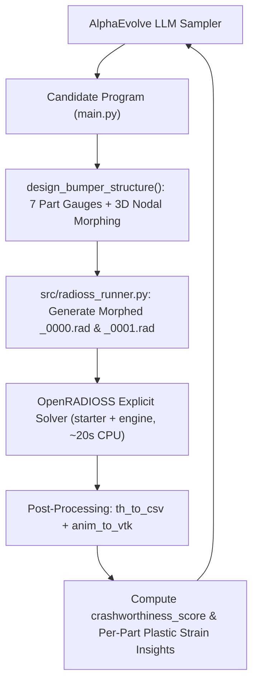
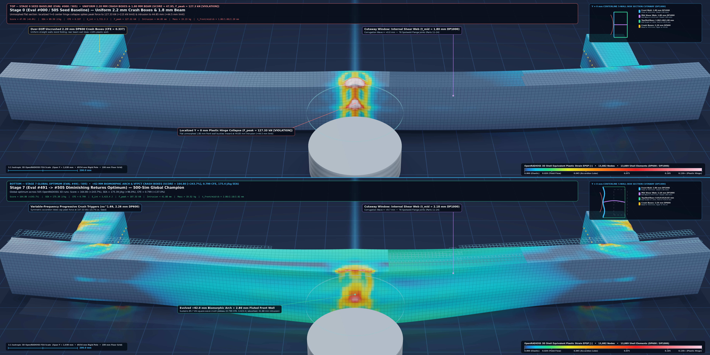
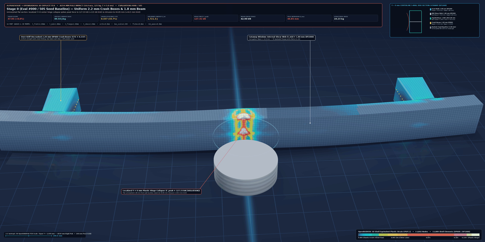

# Automotive Bumper Beam & Crash Box Optimization (OpenRADIOSS Explicit FEA)

This example evolves a generative structural design program in Python (`design_bumper_structure` in `main.py`) to optimize the crashworthiness of a **14-part, 13,832-node automotive bumper beam and crash-box assembly** impacting a vertical $\varnothing 254\text{ mm}$ cylindrical rigid pole in **OpenRADIOSS**.

Each candidate program generated by AlphaEvolve is evaluated on Google Cloud Batch by morphing the 3D finite-element mesh and shell property gauges, running a non-linear explicit dynamic crash simulation (`starter_linux64_gf_sp` + `engine_linux64_gf_sp`), extracting time-history forces/energies (`th_to_csv_linux64_gf`) and 3D deformed plastic strains (`anim_to_vtk_linux64_gf`), and computing a composite `crashworthiness_score`.

---

## Architecture & Evolutionary Workflow



---

## Structural Model & Parameterization (`models/Bumper_Beam_AP_meshed_0000.rad`)

- **Unit System**: `kg`, `mm`, `ms` (Force in `kN`, Energy in `J`, Velocity in `mm/ms = m/s`, Stress in `GPa`).
- **Materials (`/MAT/PLAS_JOHNS`)**:
  - **Crash Boxes (`Parts 4, 5, 15, 16`)**: Dual-Phase Steel **DP600** ($\rho = 7.85 \times 10^{-6}\text{ kg/mm}^3$, $E = 210\text{ GPa}$, $\nu = 0.3$, Johnson-Cook isotropic elasto-plasticity).
  - **Double-Cell Bumper Beam (`Parts 6, 7, 8, 9, 10, 17, 18, 19, 20, 21`)**: Dual-Phase Steel **DP1000** high-strength steel.
  - **Connections**: 156 spotweld spring elements (`/PROP/SPR_BEAM`) tied via `/INTER/TYPE2` kinematic interfaces, with `/INTER/TYPE7` self-contact (`Gapmin = 1.0 mm`, Coulomb friction $\mu = 0.2$).
- **Impact Boundary Conditions**:
  - Rear crash-box nodes attached to a $125\text{ kg}$ rigid Body-in-White mass (`/RBODY/1`) traveling at $V_x = -10.0\text{ m/s}$ ($36\text{ km/h}$, $E_{k,0} \approx 7.22\text{ kJ}$) into a stationary vertical $\varnothing 254\text{ mm}$ rigid cylinder (`/RWALL/CYL/1`) at $Y = 0$ for $T_{\text{stop}} = 5.0\text{ ms}$.
  - To prevent free-flight gap gaming, the rigid cylinder is automatically positioned $0.2\text{ mm}$ ahead of the morphed bumper's leading edge (`XM = X_M1 = min_node_X - 127.2 mm`).

### 1. Seven Left/Right Symmetric Shell Gauges ($\in [0.8, 3.5]\text{ mm}$)
| Parameter | Parts (L / R) | Material | Baseline Gauge | Baseline Mass | Structural Role |
| :--- | :--- | :--- | :--- | :--- | :--- |
| `t_crash_box_upper` | `4` / `15` | DP600 | `2.2 mm` | `1.97 kg` | Upper hat section of axial energy-absorbing crash boxes |
| `t_crash_box_lower` | `5` / `16` | DP600 | `2.2 mm` | `1.72 kg` | Lower hat section of axial energy-absorbing crash boxes |
| `t_beam_upper` | `6` / `17` | DP1000 | `1.8 mm` | `2.26 kg` | Top horizontal wall ($Z = +75\text{ mm}$) of bumper box beam |
| `t_beam_mid` | `7` / `18` | DP1000 | `1.8 mm` | `2.29 kg` | Internal horizontal stiffening web ($Z \approx 0\text{ mm}$) |
| `t_beam_lower` | `8` / `19` | DP1000 | `1.8 mm` | `2.26 kg` | Bottom horizontal wall ($Z = -75\text{ mm}$) of bumper box beam |
| `t_beam_front` | `9` / `20` | DP1000 | `1.8 mm` | `4.32 kg` | Front impact face directly striking the rigid pole |
| `t_beam_rear` | `10` / `21` | DP1000 | `1.8 mm` | `4.27 kg` | Rear backing wall of the double-cell bumper beam |

### 2. Seven Continuous 3D Nodal Geometry Morphing Parameters
All nodal coordinate transformations use smooth window functions ($\cos^2$ across the central bumper span $|Y| < 680\text{ mm}$ and $\sin^2$ across the crash-box axial interior $X \in [122, 298]\text{ mm}$) that vanish identically at spotweld and rigid-body boundaries:
- `beam_arch_depth_mm` ($\in [-20.0, 25.0]\text{ mm}$): Forward bow ($\Delta X$) at the impact center $Y = 0$.
- `beam_depth_scale` ($\in [0.75, 1.35]$): Scales the central box depth ($X$-thickness) relative to the rear wall.
- `beam_height_taper` ($\in [-0.25, 0.25]$): Scales the vertical section height ($Z$) at the center span.
- `front_flute_depth_mm` ($\in [-12.0, 12.0]\text{ mm}$): Horizontal stiffening flute indentation on the front impact face.
- `mid_rib_corrugation_mm` ($\in [-15.0, 15.0]\text{ mm}$): Spanwise vertical corrugation wave on the internal horizontal stiffening web.
- `crash_box_taper` ($\in [-0.15, 0.15]$): Axial cross-sectional flare/taper along the crash boxes.
- `crash_box_bead_amp_mm` ($\in [-6.0, 6.0]\text{ mm}$): Alternating out-of-phase sinusoidal crush-trigger beads along the crash-box walls.
- `custom_morph_fn` *(optional callable)*: `fn(x, y, z, region) -> (dx, dy, dz)` allowing AlphaEvolve to synthesize custom mathematical 3D surface morphing functions.

---

## Mathematical Objective Function (`crashworthiness_score`)

AlphaEvolve maximizes the composite crashworthiness score:

$$\text{Score} = \text{SEA} \cdot \left(0.70 + 0.30 \cdot \text{CFE}\right) - P_{\text{force}} - P_{\text{intrusion}} - P_{\text{energy}}$$

where:
- **Specific Energy Absorption ($\text{SEA}$)**: $\text{SEA} = \frac{E_{\text{internal}}}{m_{\text{structural}}}$ ($\text{J/kg}$)
- **Crush Force Efficiency ($\text{CFE}$)**: $\text{CFE} = \frac{F_{\text{mean}}}{F_{\text{peak}}} \in [0, 1]$
- **Peak Impact Force Penalty**: $P_{\text{force}} = 1.5 \cdot \max(0,\, F_{\text{peak}} - 115.0\text{ kN})$
- **Pole Intrusion Penalty**: $P_{\text{intrusion}} = 15.0 \cdot \max(0,\, \delta_{\max} - 44.5\text{ mm})$
- **Energy Shortfall Penalty**: $P_{\text{energy}} = 0.08 \cdot \max(0,\, 1700.0\text{ J} - E_{\text{internal}})$

---

## Baseline Score vs. Evolved Performance (Cloud Batch Run)





| Metric | Baseline Seed Design | AlphaEvolve Best (`8245194633735919322`) | Improvement |
| :--- | :--- | :--- | :--- |
| **`crashworthiness_score`** | **`47.95`** | **`115.77`** | **`+141.4%` (2.41x)** |
| **Specific Energy Absorption ($\text{SEA}$)** | `89.51 J/kg` | `132.67 J/kg` | **`+48.2%`** |
| **Structural Mass ($m_{\text{structural}}$)** | `19.23 kg` | `17.43 kg` | **`-9.4%` lighter** |
| **Absorbed Internal Energy ($E_{\text{internal}}$)** | `1,721.3 J` | `2,312.4 J` | **`+34.3%` more energy** |
| **Peak Rigid-Wall Force ($F_{\text{peak}}$)** | `127.31 kN` | `97.53 kN` | **`-23.4%` lower peak load** |
| **Crush Force Efficiency ($\text{CFE}$)** | `0.337` | `0.575` | **`+70.7%` smoother crush** |
| **Max Rigid-Pole Intrusion ($\delta_{\max}$)** | `44.85 mm` | `43.78 mm` | **`-1.07 mm` less intrusion** |

---

## How to Deploy and Run

1. Ensure the AlphaEvolve base infrastructure is deployed in your project (`alpha-evolve-infra.yaml`).
2. Deploy the `bumper_beam_crash` experiment using Cluster Toolkit (`gcluster`):
   ```bash
   gcluster deploy alpha-evolve-experiment.yaml \
     -d alpha-evolve-deployment.yaml \
     -o ../deployment \
     --vars project_id=${PROJECT_ID} \
     --vars existing_bucket_name=${BUCKET_NAME} \
     --vars region=us-central1 \
     --vars user_experiment_name=bumper-crash \
     --vars example_dir=user_examples/bumper_beam_crash \
     --vars evaluation_machine_type=n2-standard-4 \
     --vars max_programs_evaluated=15 \
     --vars max_programs_generated=40 \
     --vars concurrency=4 \
     --vars max_duration=6 \
     --vars idle_timeout=5 \
     -w --auto-approve
   ```
3. Launch the controller job via the Vertex AI Colab Enterprise notebook (`gs://${BUCKET_NAME}/notebook/run_notebook.ipynb`) or directly via `gcloud batch jobs submit`.
4. Upon completion, comparison plots (`crash_response_comparison.png`, `bumper_deformed_mesh_comparison.png`) and `best_bumper_design.json` are automatically uploaded to `gs://<bucket_name>/bumper-crash/results/`.
