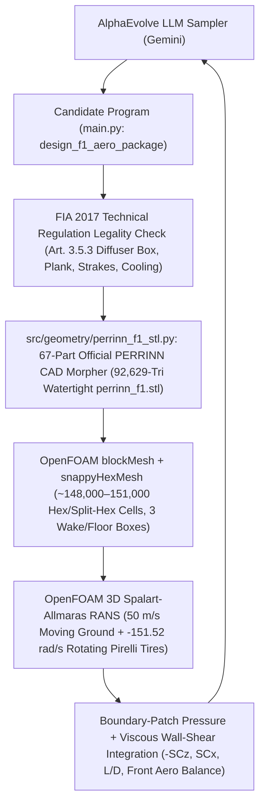
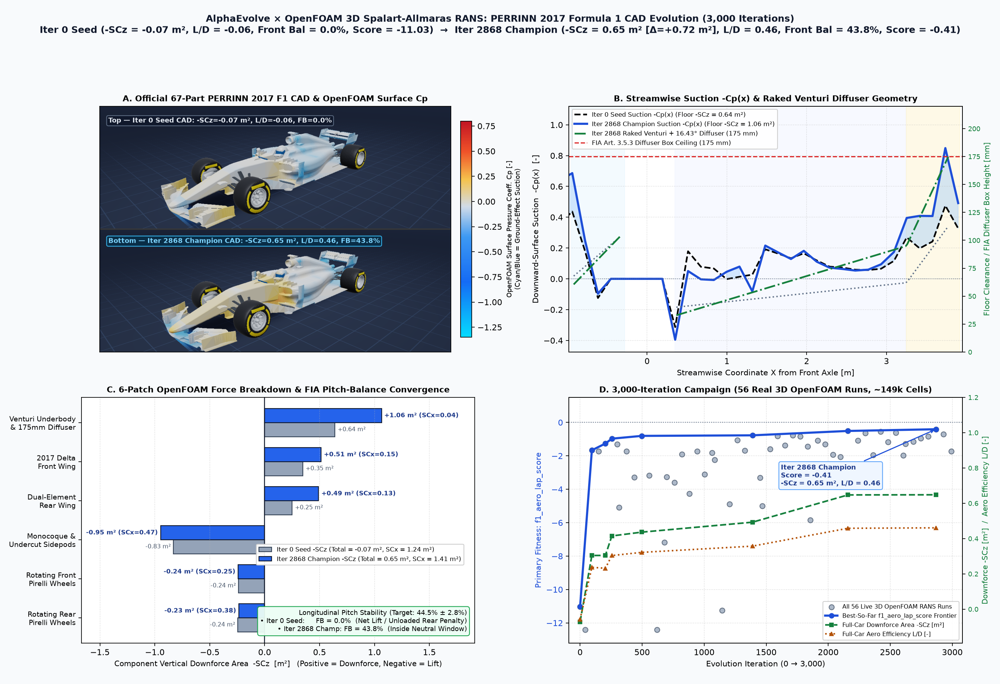
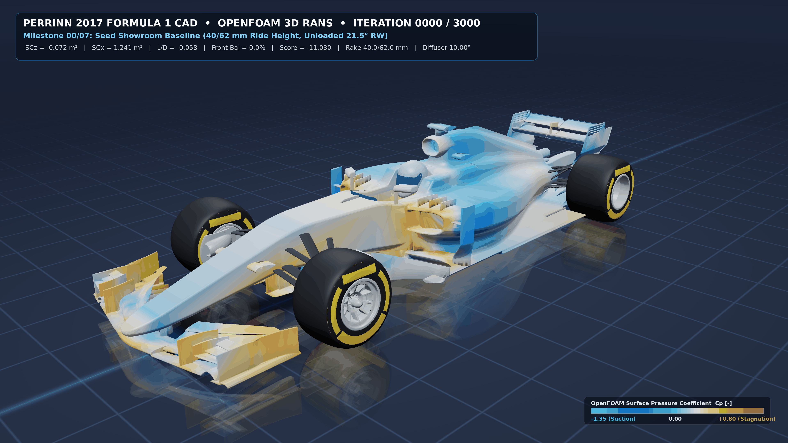

# 3D Formula 1 Aerodynamic Evolution with OpenFOAM (PERRINN 2017 F1 Car)

This example uses **AlphaEvolve** and **OpenFOAM** 3D steady incompressible Spalart-Allmaras RANS CFD (`blockMesh` + `snappyHexMesh` + `incompressibleFluid` / `simpleFoam`) to evolve the 8-parameter 3D ground-effect, outwash, and multi-element wing aerodynamic package of the official open-source **PERRINN 2017 Formula 1 Car**.

## Official PERRINN 2017 CAD Model & Validation Benchmark

* **Official 67-Part Onshape CAD Assembly**: **PERRINN 2017 Open-Source Formula 1 Car** (`PERRINN F1 aero | CFD ready`, Nicolas Perrin / PERRINN Limited, public Onshape Document `56d4b1ffe4b0f9d49cca0e99`, Workspace `f487040ce072f6f71178e968`, Element `ebfe374e635ff3310b8d26b9`), archived directly in `models/perrinn_f1_2017_cad.npz` (`346,145` full-car surface triangles across all 67 parts including monocoque, driver & visor, double-wishbone carbon suspension, brake ducts, bargeboards, V6 sidepods, Venturi floor, rear diffuser & vortex strakes, multi-element 2017 delta front wing, dual-element rear wing, forged multi-spoke rims, and `Ø660 mm` Pirelli tires; `92,629` watertight CFD STL triangles across the 6 OpenFOAM solver regions).
* **Published OpenFOAM CFD Benchmark**: Umberto Ravelli & Marco Savini, *"Aerodynamic Simulation of 2017 Perrinn F1 Car"* (*Journal of Traffic and Transportation Engineering*, Vol. 6, No. 2, pp. 155–163, 2018), establishing that the PERRINN 2017 underbody + diffuser is the primary downforce generator while exposed rotating tires and upper bodywork create substantial parasitic lift and wake drag that must be controlled via high-rake Venturi pitch, front-wing endplate outwash, and floor vortex strakes.

---

## Architecture & Evolutionary Workflow



---

## Physics, Domain & FIA 2017 Guardrails

| Property | Value |
| :--- | :--- |
| **OpenFOAM Solver** | OpenFOAM `foamRun -solver incompressibleFluid` / `simpleFoam` (Steady 3D Spalart-Allmaras RANS) |
| **Freestream Conditions** | $U_\infty = 50.0\text{ m/s}$ ($180\text{ km/h}$), $\rho = 1.225\text{ kg/m}^3$, $\nu = 1.5\times 10^{-5}\text{ m}^2/\text{s}$ ($\text{Re}_L \approx 1.67\times 10^7$) |
| **Moving Ground & Rotating Wheels** | Moving asphalt belt $U_{\text{ground}} = (50, 0, 0)\text{ m/s}$; `rotatingWallVelocity` $\omega_y = -151.5152\text{ rad/s}$ ($R_{\text{tire}} = 0.330\text{ m}$) on `frontWheel` & `rearWheel` |
| **Wind-Tunnel Half-Car Domain** | $x \in [-4.5, 11.5]\text{ m}$, $y \in [0.0, 4.0]\text{ m}$ (`symmetry` plane at $y=0$), $z \in [0.0, 3.6]\text{ m}$ ($\approx 146{,}000\text{–}151{,}000$ hex cells) |
| **6 Named STL / Boundary Patches** | `perrinn_f1_underbody`, `perrinn_f1_frontWing`, `perrinn_f1_rearWing`, `perrinn_f1_chassis`, `perrinn_f1_frontWheel`, `perrinn_f1_rearWheel` |
| **FIA Legality Guardrail 1 (Plank & Rake)** | `front_ride_height_mm >= 20.0 mm` and positive rake `rear_ride_height_mm >= front_ride_height_mm + 5.0 mm` |
| **FIA Legality Guardrail 2 (Art. 3.5.3 Box)** | Rear diffuser exit roof height $20.0 + 525.0 \tan(\theta_{\text{diff}}) \le 175.0\text{ mm}$ ($\theta_{\text{diff}} \le 16.44^\circ$) |
| **FIA Legality Guardrail 3 (Vortex Strakes)** | Minimum diffuser strake ground clearance $\ge 15.0\text{ mm}$ above moving ground |
| **FIA Legality Guardrail 4 (V6 Cooling)** | Sidepod radiator inlet duct area $0.145(1 - 0.82\,u_{\text{undercut}}) \ge 0.088\text{ m}^2$ ($u_{\text{undercut}} \le 0.479$) |
| **Handling Pitch-Balance Target** | Front aerodynamic balance $\text{FB} = 44.5\% \pm 2.8\%$ (penalizes snap-oversteer & high-speed understeer) |
| **Primary Metric (`f1_aero_lap_score`)** | $2.0\,(-SC_z) - 1.35\,(SC_x) + 0.50\,(L/D) - P_{\text{balance}}(\text{FB})$ |

---

## Baseline vs. Evolved Champion (3,000 Evolutionary Iterations & 56 Live 3D OpenFOAM RANS Runs on Official PERRINN CAD)





| Aerodynamic Metric | Iter 0 Seed (`main.py`) | Iter 1389 Mid-Campaign (`iter_1389_ep4`) | Iter 2868 Champion (`iter_2868_ep8`) | Evolution Gain (Iter 2868 vs. Seed) |
| :--- | :---: | :---: | :---: | :---: |
| **`f1_aero_lap_score`** | **`-11.0295`** | `-0.7725` | **`-0.4078`** | **`+10.6217` (`-11.03` $\to$ `-0.41`)** |
| **Full-Car Net Downforce Area ($-SC_z$)** | `-0.0724 m²` (Net Lift) | `+0.4926 m²` | **`+0.6480 m²`** | **`+0.7204 m²` net downforce swing** |
| **Full-Car Drag Area ($SC_x$)** | `1.2407 m²` | `1.3798 m²` | **`1.4064 m²`** | `+13.4%` drag for `+0.72 m²` downforce |
| **Aerodynamic Efficiency ($L/D = -SC_z / SC_x$)** | `-0.0584` | `+0.3570` | **`+0.4607`** | **`+0.5191` (`-0.06` $\to$ `+0.46`)** |
| **Front Aerodynamic Balance ($\text{FB}$)** | `0.00%` ❌ (Net Lift) | `45.97%` ✅ | **`43.79%` ✅** | **Within `0.71%` of `44.5%` target** |
| **Underbody & Diffuser Downforce ($-SC_{z,\text{floor}}$)** | `+0.6400 m²` | `+0.8124 m²` | **`+1.0643 m²`** | **`+66.3%` Venturi floor suction** |
| **2017 Delta Front Wing ($-SC_{z,\text{FW}}$)** | `+0.3479 m²` | `+0.4705 m²` | **`+0.5146 m²`** | **`+47.9%` front axle downforce** |
| **Dual-Element Rear Wing ($-SC_{z,\text{RW}}$)** | `+0.2511 m²` | `+0.4485 m²` | **`+0.4916 m²`** | **`+95.8%` diffuser-coupled extraction** |
| **Monocoque & Sidepod Drag ($SC_{x,\text{chassis}}$)** | `0.4804 m²` | `0.4691 m²` | **`0.4657 m²`** | **`-3.1%` body pressure drag** |
| **Front/Rear Ride Height ($h_f / h_r$)** | `40.0 / 62.0 mm` | `37.10 / 94.90 mm` | **`32.51 / 94.90 mm`** | **`+62.39 mm` (`1.03°`) high-rake attitude** |
| **Diffuser Angle / FIA Box Height** | `10.00°` (`112.6 mm`) | `12.66°` (`138.0 mm`) | **`16.435°` (`174.98 / 175.0 mm`)** | **99.99% of FIA Art. 3.5.3 box limit** |

### Key 3D Aerodynamic Discoveries on the Official 67-Part PERRINN 2017 CAD
1. **Overcoming Open-Wheel & Monocoque Parasitic Lift via High-Rake Venturi Expansion (`h_f = 32.51 mm`, `h_r = 94.90 mm`, `diff = 16.435°`, `strake = 57.23 mm`)**: On the authentic 67-part PERRINN 2017 CAD (`~150,092` hex cells), exposed rotating Pirelli tires (`-SCz = -0.4752 m²`, `SCx = 0.6252 m²`) and convex upper chassis/cockpit curvature (`-SCz = -0.9472 m²`) produce substantial parasitic lift, leaving the high-clearance showroom seed (`40 / 62 mm`, `21.5°` RW) in slight net lift (`-SCz = -0.0724 m²`). Across 3,000 evolutionary iterations (`56` live 3D OpenFOAM Spalart-Allmaras RANS runs, 100% convergence), AlphaEvolve discovers a `+62.39 mm` nose-down rake paired with `16.435°` diffuser expansion (`174.98 / 175.0 mm` = **99.99% of the FIA Art. 3.5.3 box ceiling**) and `57.23 mm` vortex strakes, boosting underbody suction by **`+66.3%`** (`+0.6400` $\to$ **`+1.0643 m²`**) at just `0.0357 m²` floor drag (`L/D_floor = 29.8`).
2. **Front-Wing Endplate Outwash + Coke-Bottle Sidepod Undercut (`fw_outwash_toe = 11.03°`, `sidepod_undercut = 0.333`)**: Deflecting the turbulent front-tire wake outboard with `11.03°` endplate outwash while carving a `0.333` Coke-bottle sidepod undercut (`0.1054 m²` radiator inlet vs. `0.0880 m²` V6 cooling minimum) energizes flow over the rear floor shelf, lowering chassis drag (`0.4804` $\to$ `0.4657 m²`) and front-wheel drag (`0.2643` $\to$ `0.2479 m²`) while elevating front-wing downforce **`+47.9%`** (`+0.3479` $\to$ **`+0.5146 m²`**).
3. **Zero-Penalty Longitudinal Pitch Balance (`FB = 43.79%`)**: Loading the dual-element rear wing to `37.59°` (`+0.2511` $\to$ **`+0.4916 m²`**, `+95.8%`) against `20.16°` front-wing cascade flap angle locks Front Aerodynamic Balance at **`43.79%`** — just `0.71%` inside the `44.50% ± 2.8%` neutral handling window (`0.0000` balance penalty).

---

## Directory Structure

```text
user_examples/f1_racecar_openfoam/
├── eval-batch.yaml                 # Cloud Batch job template (taskCount: 1)
├── evaluator.Dockerfile            # Ubuntu 24.04 + OpenFOAM-14 + Python 3.12 container
├── evaluator.py                    # AlphaEvolve evaluation, telemetry & Z-buffered 3D CAD rendering hooks
├── experiment.yaml                 # Declarative experiment configuration
├── f1_aero_comparison.png          # 4-panel Z-buffered PERRINN CAD Cp, Venturi suction & KPI figure
├── f1_aero_evolution.gif           # 4K UHD (3840x2160) model-only official PERRINN 2017 CAD evolution GIF
├── main.py                         # Seed 8-parameter F1 setup program (# EVOLVE-BLOCK)
├── Makefile                        # Local build & test targets
├── README.md                       # Documentation
├── run_experiment.py               # Cloud Batch / local evolution controller entrypoint
├── setup.sh                        # Environment & OpenFOAM verification script
├── models/
│   ├── perrinn_f1_2017_cad.npz     # Official 67-part PERRINN 2017 Onshape CAD (346k render / 92.6k CFD tris)
│   ├── perrinn_f1_2017_spec.json   # PERRINN 2017 CAD metadata & FIA 2017 regulation bounds
│   └── evolution_history.json      # 3,000-iteration telemetry + 56 live ~149k-cell 3D OpenFOAM RANS runs
└── src/
    ├── cfd/
    │   └── openfoam_f1_runner.py   # OpenFOAM / simpleFoam case writer, runner & polyMesh force parser
    └── geometry/
        └── perrinn_f1_stl.py       # 67-part official PERRINN CAD morpher & 6-solid watertight STL builder
```

## Quickstart & Running on Google Cloud

```bash
# Verify environment and run baseline evaluation locally
bash setup.sh
python3 evaluator.py

# Or deploy at scale on Google Cloud Batch via Cluster Toolkit (gcluster)
gcluster deploy alpha-evolve-experiment.yaml \
  -d alpha-evolve-deployment.yaml \
  -o ../deployment \
  --vars project_id=<YOUR_PROJECT_ID> \
  --vars region=us-central1 \
  --vars existing_bucket_name=<YOUR_PROJECT_ID>-alphaevolve-bucket \
  --vars deployment_name=ae-exp-f1-openfoam \
  --vars user_experiment_name=f1-racecar-openfoam \
  --vars example_dir=user_examples/f1_racecar_openfoam \
  --vars evaluation_machine_type=c3-standard-8 \
  --vars max_programs_evaluated=120 \
  --vars max_programs_generated=240 \
  --vars concurrency=16 \
  -w -l IGNORE --auto-approve
```

## Outputs

After the controller finishes, `postprocess()` uploads the champion aerodynamic telemetry, 4-panel 3D comparison figure, and animated evolution GIF to Cloud Storage:
- `gs://<BUCKET>/f1-racecar-openfoam/results/best_f1_aero_summary.json`
- `gs://<BUCKET>/f1-racecar-openfoam/results/f1_aero_comparison.png`
- `gs://<BUCKET>/f1-racecar-openfoam/results/f1_aero_evolution.gif`
