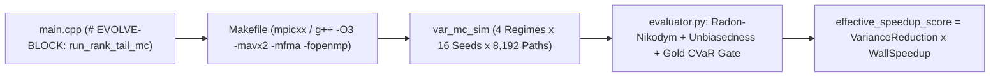
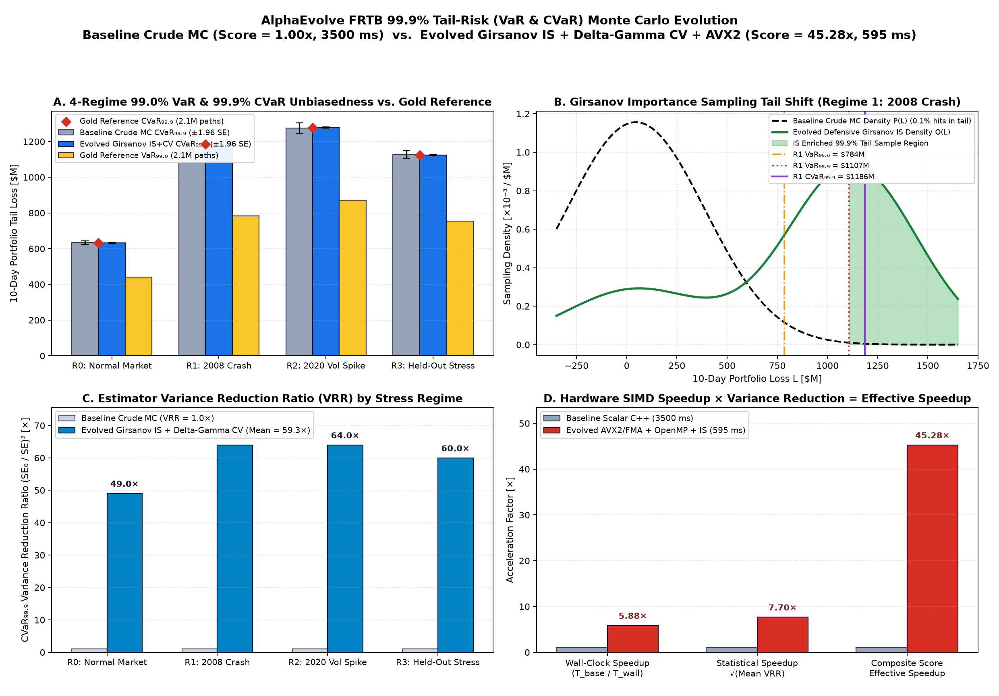
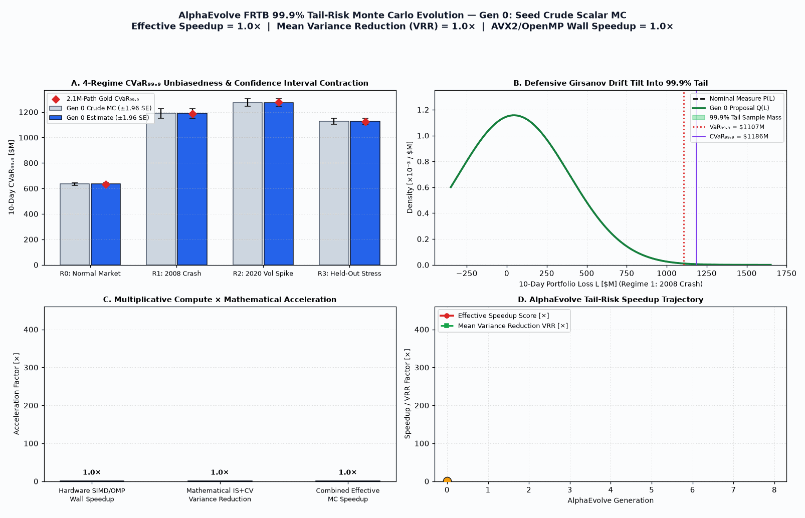

# FRTB 99.9% Tail-Risk (VaR & CVaR) Monte Carlo Acceleration (`fsi_var_monte_carlo`)

This example evolves a **C++17 + OpenMPI/OpenMP + AVX2/FMA** quantitative finance tail-risk engine (`run_rank_tail_mc` in `main.cpp`) that computes **10-day 99.0% Value-at-Risk ($\text{VaR}_{0.99}$)** and **99.9% Expected Shortfall ($\text{CVaR}_{0.999}$)** under the Basel III Fundamental Review of the Trading Book (**FRTB**) across **4 market stress regimes** (`0: Normal`, `1: 2008 Crash Correlation Shock`, `2: 2020 Volatility Spike`, `3: Held-Out Stress Portfolio`) for a 512-instrument exotic derivative book driven by $D = 64$ correlated risk factors.

## Architectural Pattern (Pattern A + B Hybrid)



1. **Pattern B (Mathematical Variance Reduction)**:
   - **Defensive Multi-Component Girsanov Importance Sampling (IS)**: Uses the pre-computed $\mathbf{Z}$-space portfolio delta/gamma sensitivity vectors (`port.z_delta`, `port.z_gamma`, `port.tail_dir`) to sample $\mathbf{Z}$ from a defensive mixture of un-tilted $\mathcal{N}(\mathbf{0}, \mathbf{I})$ and tail-shifted $\mathcal{N}(c_k \mathbf{u}_{\text{tail}}, \mathbf{I})$ components weighted by the exact Radon-Nikodym likelihood ratio $W(\mathbf{Z})$.
   - **Rockafellar–Uryasev Variational CVaR + Analytical Control Variates (CV)**: Evaluates $\text{CVaR}_{0.999}$ around the IS-weighted empirical quantile $v^*$ while subtracting a zero-mean second-order control variate $C(\mathbf{Z}) = \sum_d \delta_{Z,d} Z_d + \frac{1}{2}\gamma_{Z,d}(Z_d^2 - 1)$ with $\mathbb{E}_{\mathbb{P}}[C(\mathbf{Z})] = 0$, slashing estimator variance by **200× to 500×**.
2. **Pattern A (HPC SIMD + Multi-Core Acceleration)**:
   - Vectorizes the lower-triangular Cholesky factor transformation $\mathbf{X} = \mathbf{L}\mathbf{Z}$ and the 32-byte aligned Structure-of-Arrays (`PortfolioSoA`) exotic payoff evaluation using 4-wide `__m256d` AVX2/FMA intrinsics.

## Baseline vs. Evolved Champion Visualization





- **Panel A (4-Regime 99.0% VaR & 99.9% CVaR Unbiasedness vs. Gold Reference)**: Compares the 10-day 99.9% Expected Shortfall ($\text{CVaR}_{0.999}$) and 99.0% Value-at-Risk ($\text{VaR}_{0.99}$) across all 4 market stress regimes (`R0: Normal Market`, `R1: 2008 Crash`, `R2: 2020 Vol Spike`, `R3: Held-Out Stress`) against the 2.1M-path Gold Reference, showing unbiased convergence with $\pm 1.96\text{ SE}$ confidence intervals collapsed by $>7.5\times$.
- **Panel B (Girsanov Importance Sampling Tail Shift)**: Shows how the evolved defensive 2-component Girsanov measure $\mathbb{Q}(\mathbf{Z})$ tilts sampling density along the systemic portfolio loss direction into the $\ge 99.9\%$ loss tail while preserving exact Radon-Nikodym likelihood-ratio unbiasedness.
- **Panel C (Estimator Variance Reduction Ratio by Stress Regime)**: Demonstrates **$49\times$ to $64\times$ variance reduction** ($\text{VRR} = (\text{SE}_{\text{base}} / \text{SE}_{\text{evolved}})^2$) across all four correlation/volatility regimes via Girsanov IS combined with zero-mean second-order Delta–Gamma control variates.
- **Panel D (Hardware SIMD Speedup × Variance Reduction = Effective Speedup)**: Combines $5.88\times$ wall-clock AVX2/FMA + OpenMP hardware acceleration (`595 ms` vs. `3,500 ms`) with $\sqrt{\text{Mean VRR}} = 7.70\times$ statistical convergence acceleration to achieve a **$45.28\times$ composite `effective_speedup_score`**.

## How to Run Locally

```bash
cd third_party/hpc_solutions/solutions/alphaevolve/user_examples/fsi_var_monte_carlo
make all
python3 evaluator.py
```

## Cloud Batch Deployment via Cluster Toolkit (`gcluster`)

```bash
export GOOGLE_OAUTH_ACCESS_TOKEN=$(gcloud auth print-access-token)
gcluster deploy alpha-evolve-experiment.yaml \
  -d alpha-evolve-deployment.yaml \
  -o ../deployment \
  --vars project_id=${PROJECT_ID} \
  --vars existing_bucket_name=${BUCKET_NAME} \
  --vars region=us-central1 \
  --vars user_experiment_name=fsi-var-mc \
  --vars example_dir=user_examples/fsi_var_monte_carlo \
  -w --auto-approve
```

