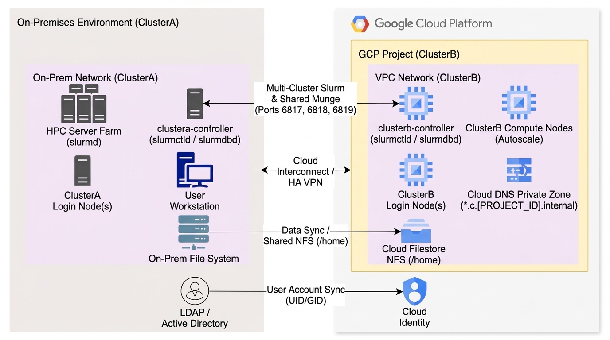
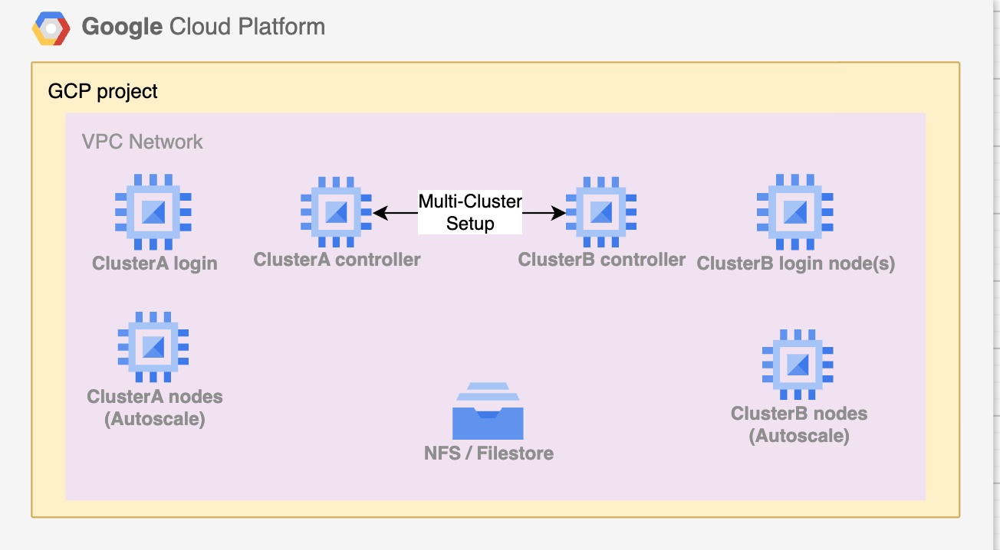

# Setting Up a Slurm Hybrid & Multi-Cluster HPC Environment on Google Cloud

> [!CAUTION]
> **Disclaimer — Experimental & Demonstration Notice**: This work is for demo and experimental purpose only. Use at your own risk. This guide and its associated blueprints, scripts, and configurations are provided "AS IS" without warranty or support of any kind, express or implied, and do not constitute an officially supported Google product. Always review, validate, and test any configurations in an isolated non-production environment before execution.

---

## Overview

This guide provides a comprehensive introduction and step-by-step setup reference for deploying a **Hybrid / Multi-Cluster Slurm HPC Environment** connecting an **On-Premises Slurm Cluster (`ClusterA`)** with a **New Auto-Scaling Google Cloud Slurm Cluster (`ClusterB`)** using the **[Google Cloud Cluster Toolkit (`gcluster`)](https://cloud.google.com/hpc-toolkit/docs/overview)** and **[SchedMD Slurm Multi-Cluster](https://slurm.schedmd.com/multi_cluster.html)** federation.

Organizations running on-premises HPC clusters (`ClusterA`) frequently experience queue congestion during peak research cycles or need on-demand access to specialized cloud hardware (such as `H3`, `H4D`, `C3`/`C4`, or GPU partitions) without changing their researchers' day-to-day Slurm submission workflows. Using Slurm's native **Multi-Cluster** architecture, you can link your **On-Premises Slurm Cluster (`ClusterA`)** with a **Google Cloud Slurm Cluster (`ClusterB`)** in your GCP project so users can stay logged into `ClusterA` and seamlessly burst, monitor, and manage jobs on `ClusterB`.

### Cluster Roles in This Guide

| Cluster Name | Controller Hostname | Environment Role | Description |
| :--- | :--- | :--- | :--- |
| **`ClusterA`** (`clustera`) | `clustera-controller` | **On-Premises Slurm Cluster** *(or simulated on-prem cluster in GCP)* | Your existing primary/on-premises Slurm environment where users log in, store scripts in `/home`, and submit jobs. *(If you are evaluating this setup without a physical on-prem cluster connected yet, you can deploy [`resources/clustera.yaml`](./resources/clustera.yaml) in GCP to simulate the on-premises cluster.)* |
| **`ClusterB`** (`clusterb`) | `clusterb-controller` | **New Google Cloud Slurm Cluster** *(in your GCP Project)* | The elastic cloud-burst Slurm cluster provisioned in your Google Cloud project via Cluster Toolkit ([`resources/clusterb.yaml`](./resources/clusterb.yaml)), featuring dynamic auto-scaling compute partitions (`idle~`) that spin up on demand when jobs are submitted from `ClusterA`. |

---

## Introduction to Slurm Multi-Cluster & Hybrid Cloud Bursting

**[Slurm Multi-Cluster](https://slurm.schedmd.com/multi_cluster.html)** allows users on the **On-Premises Cluster (`ClusterA`)** to target job submission and status queries (`sbatch -M clusterb`, `sinfo -M clusterb`, `squeue -M clusterb`) directly to the **Google Cloud Cluster (`ClusterB`)** while maintaining independent controllers (`slurmctld`) and accounting daemons (`slurmdbd`) in each environment.

### Hybrid On-Premises (`ClusterA`) to Google Cloud (`ClusterB`) Reference Architecture



### How Slurm Multi-Cluster Cloud Bursting Works

- **Keep 2 Clusters Running Independently**:
  1. **On-Premises Cluster (`ClusterA`)**: Runs your baseline on-premises compute nodes, login nodes, and local controller (`clustera-controller`).
  2. **Google Cloud Cluster (`ClusterB`)**: Runs in your GCP project with an always-on controller (`clusterb-controller`) and **auto-scaling cloud compute partitions** that scale down to zero (`idle~`) when idle and burst up automatically when jobs arrive.
- **Slurm-Native Functionality**: Implemented natively by SchedMD (`-M` / `--clusters` flag), requiring no custom job wrappers or third-party schedulers.
- **Why It Is Well-Suited for Hybrid HPC**:
  - **High Availability & Fault Isolation**: Both `ClusterA` (on-premises) and `ClusterB` (GCP) maintain their own `slurmctld` and `slurmdbd`. Temporary WAN latency spikes between on-premises and Google Cloud will not crash running jobs or destabilize either cluster's control plane.
  - **Familiar Single-Cluster User Experience**: Researchers log in to the on-premises `ClusterA` login node as usual and submit jobs to Google Cloud by simply adding `-M clusterb`.
  - **Full-Function Slurm in Both Environments**: Both `ClusterA` (on-premises) and `ClusterB` (Google Cloud) operate as complete, independent Slurm clusters.

---

## Hybrid Infrastructure Prerequisites

Before linking your **On-Premises Slurm Cluster (`ClusterA`)** with your **New Google Cloud Slurm Cluster (`ClusterB`)**, ensure the following five infrastructure pillars are configured:

### 1. Network Routing (`ClusterA` On-Premises <-> `ClusterB` GCP VPC)

A fundamental requirement for hybrid Slurm operation is **unrestricted bidirectional IP routability** between your on-premises network (`ClusterA`) and your Google Cloud VPC subnet (`ClusterB`). Constant communication between the submission node on `ClusterA`, both controllers (`clustera-controller` and `clusterb-controller`), and the cloud compute hosts (`slurmd` on `ClusterB`) is essential.

- **Production Recommendation**: Establish **[Google Cloud Dedicated Interconnect](https://cloud.google.com/network-connectivity/docs/interconnect/concepts/dedicated-overview)** (or Partner Interconnect) and configure subnet routing before beginning the setup.
- **Proof-of-Concept (PoC) / Short-Term**: **[Cloud HA VPN](https://cloud.google.com/network-connectivity/docs/vpn/concepts/overview)** is suitable for short-term testing or PoC scenarios, but production deployments should transition to Dedicated Interconnect.
- **Private Google Access**: Enable Private Google Access on the GCP VPC subnet hosting `ClusterB` so cloud nodes and storage services (such as Cloud Filestore and Cloud Storage) communicate over private IPs.

### 2. Hybrid DNS Resolution (GCP `ClusterB` <-> On-Premises `ClusterA`)

In order for the on-premises controller and servers (`ClusterA`) to dynamically resolve the hostnames of auto-scaling Google Cloud instances in `ClusterB`, hybrid DNS forwarding must be configured:

- **Pointing On-Premises DNS to Google Cloud (`*.c.<PROJECT_ID>.internal`)**: Within Google Cloud, VPC networks provide an internal DNS service that automatically creates, updates, and removes internal `A` records (`*.c.<PROJECT_ID>.internal`) and reverse `PTR` records as VM instances in `ClusterB` scale up and down. Your enterprise on-premises DNS service (`ClusterA`) must forward all traffic for `*.c.<PROJECT_ID>.internal` to Google Cloud for each GCP project hosting a Slurm cluster. Coordinate this configuration with your network team.
- **Google Cloud Private DNS Zones**: Google Cloud supports **[Cloud DNS Private Zones](https://cloud.google.com/dns/docs/zones/zones-overview#private_zones)** within project boundaries applied to specific VPCs. Private Zones allow you to host private zones in GCP, create **inbound/outbound DNS forwarding zones**, and configure **DNS peering zones** so that:
  1. On-premises `ClusterA` hosts resolve `clusterb-controller` and `clusterb-*` compute node FQDNs via inbound DNS forwarding.
  2. Google Cloud `ClusterB` hosts resolve on-premises `clustera-controller` and login node FQDNs via outbound DNS forwarding to your on-premises DNS servers.

### 3. Bidirectional Firewall Requirements

Open the following TCP ports **bidirectionally** between the on-premises `ClusterA` network and the Google Cloud `ClusterB` VPC subnet:

| Port | Daemon / Service | Direction | Purpose |
| :--- | :--- | :--- | :--- |
| **TCP `6817`** | `slurmctld` | Bidirectional (`ClusterA` <-> `ClusterB`) | Slurm Controller communication & cross-cluster job submission |
| **TCP `6818`** | `slurmd` | Bidirectional (`ClusterA` <-> `ClusterB`) | Slurm Compute Node daemon communication & job step launch |
| **TCP `6819`** | `slurmdbd` | Bidirectional (`ClusterA` <-> `ClusterB`) | Slurm Accounting Database daemon cross-registration (`AccountingStorageExternalHost`) |
| **TCP `6820+`** | `scontrol` / `srun` | Bidirectional (`ClusterA` <-> `ClusterB`) | Interactive job communication and controller RPC port range |

### 4. User Account & UID/GID Synchronization (`LDAP / AD` <-> `Cloud Identity`)

Munge authentication and shared NFS filesystems require every HPC user to have a **consistent username, UID, and GID** across both the on-premises cluster (`ClusterA`) and the Google Cloud cluster (`ClusterB`) (`User Account Sync` in the reference diagram). Synchronize your on-premises LDAP / Active Directory with **Google Cloud Identity** (with POSIX UID/GID attributes) or bind both clusters to the same LDAP/AD directory.

### 5. Shared Storage & Data Synchronization (`Data Sync`)

To allow jobs submitted from on-premises `ClusterA` to execute on GCP `ClusterB`, both clusters must have access to the required job scripts, input datasets, and working directories:
- **Hybrid Data Sync (On-Premises `ClusterA` <-> GCP `ClusterB`)**: Synchronize datasets between your on-premises file system and Google Cloud storage (**Cloud Filestore** NFS, **Google Cloud Managed Lustre**, or **Cloud Storage FUSE**), or mount a shared NFS export accessible over Cloud Interconnect.
- **Shared Cloud Filestore NFS (`/home`)**: In the walkthrough below, `ClusterB` (the new GCP Slurm cluster) mounts the shared `/home` NFS export (`nfs_address`) so user home directories, batch scripts (`testjob.sh`), and output logs (`slurmtest_%j.out`) are immediately accessible from both `ClusterA` and `ClusterB`.

---

## Hybrid & Multi-Cluster Setup Walkthrough (`ClusterA` On-Prem <-> `ClusterB` GCP)

The walkthrough below demonstrates how to deploy the **New Google Cloud Slurm Cluster (`ClusterB`)** in your GCP project (and optionally simulate the **On-Premises Slurm Cluster (`ClusterA`)** if you are testing in a standalone GCP environment), configure shared multi-cluster **Munge** authentication (`munge-multi`), federate the **`slurmdbd`** accounting databases between `ClusterA` and `ClusterB`, and burst a batch job from `ClusterA` to run on `ClusterB`.



### Bundled Reference Files (`./resources/`)

All configuration templates used in this guide are located in the [`resources/`](./resources/) directory:
- **[`resources/clustera.yaml`](./resources/clustera.yaml)**: Cluster Toolkit blueprint representing **`ClusterA`** (used when simulating the primary/on-premises Slurm cluster inside GCP along with a shared Cloud Filestore `/home` instance).
- **[`resources/clusterb.yaml`](./resources/clusterb.yaml)**: Cluster Toolkit blueprint for **`ClusterB`**, the **New Google Cloud Slurm Cluster** deployed in your GCP project (mounts the shared `/home` NFS export via `nfs_address` and provisions auto-scaling `clusterb` and `compute` partitions).
- **[`resources/munge-multi.service`](./resources/munge-multi.service)**: Systemd service unit running a dedicated multi-cluster Munge daemon on `/var/run/munge/munge.socket.multi` using `/etc/munge/munge.key.multi`.
- **[`resources/testjob.sh`](./resources/testjob.sh)**: Sample Slurm batch script submitted from `ClusterA` to execute on `ClusterB` (`sbatch -M clusterb testjob.sh`).

---

## Step 1: Build Google Cloud Cluster Toolkit & Prepare Your GCP Project

On your deployment workstation or Google Cloud Shell, prepare your GCP project to deploy the new cloud Slurm cluster (`ClusterB`):

1. **Authenticate `gcloud` and set your target GCP project ID**:
   ```bash
   gcloud auth login
   gcloud auth application-default login
   gcloud config set project <YOUR_PROJECT_ID>
   ```

2. **Enable required Google Cloud APIs and Private Google Access**:
   ```bash
   # Enable Cloud Storage, Filestore, and Compute Engine APIs
   gcloud services enable storage.googleapis.com file.googleapis.com compute.googleapis.com

   # Enable Private Google Access on the target VPC subnet (e.g., default in us-central1)
   gcloud compute networks subnets update default \
     --region=us-central1 \
     --enable-private-ip-google-access
   ```

3. **Clone and build the Google Cloud Cluster Toolkit (`gcluster`)**:
   ```bash
   git clone https://github.com/GoogleCloudPlatform/cluster-toolkit.git
   cd cluster-toolkit/
   make
   ./gcluster --version
   ```

---

## Step 2: Prepare `ClusterA` (On-Premises) and Deploy `ClusterB` (New GCP Slurm Cluster)

Copy the blueprint templates from [`resources/`](./resources/) into your `cluster-toolkit` working directory:

```bash
cp /path/to/scientific-computing-examples/hybrid-environment/resources/clustera.yaml .
cp /path/to/scientific-computing-examples/hybrid-environment/resources/clusterb.yaml .
```

### 1. Prepare `ClusterA` (On-Premises Cluster or Simulated On-Premises Cluster)

- **If you are connecting an existing On-Premises Slurm Cluster (`ClusterA`)**:
  Ensure your on-premises controller (`clustera-controller`) is reachable over Cloud Interconnect / HA VPN from your GCP VPC and note the IP address of the shared NFS server (or Cloud Filestore instance) that will be mounted on `ClusterB`.
- **If you are simulating `ClusterA` inside Google Cloud for testing/PoC**:
  1. Edit `clustera.yaml` and replace `<YOUR_PROJECT_ID>` with your GCP project ID:
     ```yaml
     vars:
       project_id: <YOUR_PROJECT_ID>
       deployment_name: clustera
       region: us-central1
       zone: us-central1-a
     ```
  2. Deploy `ClusterA` using `gcluster` (takes ~15 minutes and provisions the shared Cloud Filestore `/home` NFS server):
     ```bash
     ./gcluster deploy clustera.yaml --auto-approve
     ```

### 2. Deploy `ClusterB` (The New Slurm Cluster in Your GCP Project)

1. **Identify the shared NFS / Cloud Filestore IP address (`IP_ADDRESS`)**:
   If using the Cloud Filestore instance created in GCP, run:
   ```bash
   gcloud filestore instances list --format="table(name,zone,networks[0].ipAddresses[0]:label=IP_ADDRESS)"
   ```
   Record the `IP_ADDRESS` of the NFS server.

2. **Configure `clusterb.yaml` for your GCP Project**:
   Edit `clusterb.yaml` and update `project_id` to your GCP project ID and `nfs_address` to the shared NFS / Filestore IP address:
   ```yaml
   vars:
     project_id: <YOUR_PROJECT_ID>
     deployment_name: clusterb
     region: us-central1
     zone: us-central1-a
     nfs_address: <FILESTORE_OR_SHARED_NFS_IP_ADDRESS>
   ```

3. **Deploy the new GCP Slurm cluster (`ClusterB`)**:
   ```bash
   ./gcluster deploy clusterb.yaml --auto-approve
   ```

4. **Open SSH sessions to both controllers**:
   Open two terminal windows—one connected to **`clustera-controller` (On-Premises Cluster A)** and one connected to **`clusterb-controller` (GCP Cluster B)**:
   ```bash
   # Window 1: On-Premises ClusterA controller (or via gcloud compute ssh if simulated in GCP)
   gcloud compute ssh clustera-controller --zone=us-central1-a

   # Window 2: New GCP ClusterB controller
   gcloud compute ssh clusterb-controller --zone=us-central1-a
   ```

---

## Step 3: Configure Shared Multi-Cluster Munge Authentication (`ClusterA` <-> `ClusterB`)

Each Slurm cluster uses its own primary Munge key (`/etc/munge/munge.key`) for internal node authentication. To authenticate cross-cluster traffic between **On-Premises `ClusterA`** and **GCP `ClusterB`**, create a shared multi-cluster Munge key (`/etc/munge/munge.key.multi`) and run a dedicated `munge-multi` service listening on `/var/run/munge/munge.socket.multi` on both controllers.

### 1. Generate the Shared Munge Key on On-Premises `ClusterA` (`clustera-controller`)

In your **`clustera-controller` (On-Premises Cluster A)** terminal window, generate `/etc/munge/munge.key.multi` and copy it to the shared `/home` directory (or transfer it via `scp` to `clusterb-controller`):

```bash
# Generate a 1024-byte random Munge key on ClusterA controller
sudo dd if=/dev/urandom bs=1 count=1024 | sudo tee /etc/munge/munge.key.multi > /dev/null
sudo chmod 400 /etc/munge/munge.key.multi
sudo chown munge:munge /etc/munge/munge.key.multi

# Copy the key to the shared home directory so GCP ClusterB can read it
sudo cp /etc/munge/munge.key.multi ~/munge.key.multi
sudo chmod 600 ~/munge.key.multi
sudo chown $USER:$USER ~/munge.key.multi
```

### 2. Install the Shared Munge Key on GCP `ClusterB` (`clusterb-controller`)

In your **`clusterb-controller` (GCP Cluster B)** terminal window, install `/etc/munge/munge.key.multi` with `munge:munge` ownership and `0400` permissions:

```bash
sudo cp ~/munge.key.multi /etc/munge/munge.key.multi
sudo chown munge:munge /etc/munge/munge.key.multi
sudo chmod 400 /etc/munge/munge.key.multi
rm -f ~/munge.key.multi
```

### 3. Configure and Start the `munge-multi` Service on BOTH Controllers

Run the following commands on **BOTH `clustera-controller` (On-Premises) and `clusterb-controller` (GCP)** to register and start the `munge-multi` systemd service (see [`resources/munge-multi.service`](./resources/munge-multi.service)):

```bash
sudo tee /etc/systemd/system/munge-multi.service > /dev/null <<'EOF'
[Unit]
Description=Munge Multi-Cluster Authentication
After=network.target

[Service]
Type=forking
ExecStart=/usr/sbin/munged --socket=/var/run/munge/munge.socket.multi \
    --key-file=/etc/munge/munge.key.multi \
    --pid-file=/var/run/munge/munged.multi.pid
User=munge
Group=munge

[Install]
WantedBy=multi-user.target
EOF

sudo systemctl daemon-reload
sudo systemctl enable --now munge-multi
```

---

## Step 4: Configure Cross-Cluster Slurm Accounting (`ClusterA` On-Prem <-> `ClusterB` GCP)

Next, configure `/etc/slurm/slurm.conf` and `/etc/slurm/slurmdbd.conf` on both controllers so that:
- **On-Premises `ClusterA` (`clustera-controller`)** points `AccountingStorageExternalHost` to the **GCP `ClusterB` controller (`clusterb-controller:6819`)**.
- **GCP `ClusterB` (`clusterb-controller`)** points `AccountingStorageExternalHost` to the **On-Premises `ClusterA` controller (`clustera-controller:6819`)**.
- Both controllers authenticate cross-cluster accounting traffic using `/var/run/munge/munge.socket.multi`.

> [!WARNING]
> **Do Not Duplicate Parameters**: Update existing keys in `/etc/slurm/slurm.conf` and `/etc/slurm/slurmdbd.conf` in place rather than blindly copying and pasting duplicate lines, as duplicated parameters will trigger daemon startup errors.

### 1. Configure On-Premises `ClusterA` (`clustera-controller`)

1. Edit `/etc/slurm/slurm.conf` on **`clustera-controller` (On-Premises)**:
   ```bash
   sudo vi /etc/slurm/slurm.conf
   ```
   Update the accounting storage settings to point `AccountingStorageExternalHost` to GCP `clusterb-controller:6819`:
   ```ini
   AccountingStorageType=accounting_storage/slurmdbd
   # Update this line:
   AccountingStorageHost=localhost

   # Add the following lines to federate with GCP ClusterB:
   AccountingStoragePort=6819
   AccountingStorageExternalHost=clusterb-controller:6819
   AccountingStoragePass=/var/run/munge/munge.socket.multi
   ```

2. Edit `/etc/slurm/slurmdbd.conf` on **`clustera-controller` (On-Premises)**:
   ```bash
   sudo vi /etc/slurm/slurmdbd.conf
   ```
   Update the Munge socket and database host configuration:
   ```ini
   AuthType=auth/munge
   # Add the following line:
   AuthInfo=socket=/var/run/munge/munge.socket.multi

   DbdHost=clustera-controller
   # Add the following lines:
   DbdPort=6819
   StorageLoc=slurm_acct_db
   ```

### 2. Configure New GCP `ClusterB` (`clusterb-controller`)

1. Edit `/etc/slurm/slurm.conf` on **`clusterb-controller` (GCP)**:
   ```bash
   sudo vi /etc/slurm/slurm.conf
   ```
   Update the accounting storage settings to point `AccountingStorageExternalHost` back to On-Premises `clustera-controller:6819`:
   ```ini
   AccountingStorageType=accounting_storage/slurmdbd
   # Update this line:
   AccountingStorageHost=localhost

   # Add the following lines to federate with On-Premises ClusterA:
   AccountingStoragePort=6819
   AccountingStorageExternalHost=clustera-controller:6819
   AccountingStoragePass=/var/run/munge/munge.socket.multi
   ```

2. Edit `/etc/slurm/slurmdbd.conf` on **`clusterb-controller` (GCP)**:
   ```bash
   sudo vi /etc/slurm/slurmdbd.conf
   ```
   Update the Munge socket and database host configuration:
   ```ini
   AuthType=auth/munge
   # Add the following line:
   AuthInfo=socket=/var/run/munge/munge.socket.multi

   DbdHost=clusterb-controller
   # Add the following line:
   DbdPort=6819

   StorageType=accounting_storage/mysql
   StorageHost=localhost
   # Add the following line:
   StorageLoc=slurm_acct_db
   ```

### 3. Restart `slurmdbd` and Reconfigure Slurm on BOTH Controllers

Run the following commands on **BOTH `clustera-controller` (On-Premises) and `clusterb-controller` (GCP)**:

```bash
sudo systemctl restart slurmdbd
sleep 5
sudo /usr/local/bin/scontrol reconfigure
```

---

## Step 5: Verify Hybrid Cross-Registration & Burst Jobs from On-Premises (`ClusterA`) to GCP (`ClusterB`)

### 1. Verify Cross-Cluster Registration (`sacctmgr show cluster`)

Run `sacctmgr show cluster` on **On-Premises `clustera-controller`** and on **GCP `clusterb-controller`** to confirm that both the on-premises cluster (`clustera`) and the new GCP cluster (`clusterb`) are registered:

```bash
sacctmgr show cluster
```

Expected output on both controllers:
```text
   Cluster     ControlHost  ControlPort   RPC
---------- --------------- ------------ -----
  clustera       127.0.0.1         6820 11264
  clusterb     10.10.0.111         6820 11264
```

### 2. Inspect GCP `ClusterB` Partitions from On-Premises `ClusterA` (`sinfo -M clusterb`)

From **On-Premises `clustera-controller`**, inspect the cloud partitions available on **GCP `ClusterB`**:

```bash
sinfo -M clusterb
```

Expected output:
```text
CLUSTER: clusterb
PARTITION AVAIL  TIMELIMIT  NODES  STATE NODELIST
clusterb*    up   infinite      4  idle~ clusterb-debugbnodeset-[0-3]
compute      up   infinite     20  idle~ clusterb-computebnodese-[0-19]
```
*(The `idle~` state shows that the cloud nodes in GCP `ClusterB` are currently powered down in auto-saving mode and ready to scale up on demand.)*

### 3. Submit a Burst Job from On-Premises `ClusterA` to GCP `ClusterB` (`sbatch -M clusterb`)

1. While logged into **On-Premises `clustera-controller`**, create (or copy from [`resources/testjob.sh`](./resources/testjob.sh)) the sample batch script in your shared home directory:
   ```bash
   cat << 'EOF' > ~/testjob.sh
   #!/bin/bash
   #SBATCH --job-name=slurmtest         # Name of the job
   #SBATCH --output=slurmtest_%j.out    # Standard output log (%j is replaced by the Job ID)
   #SBATCH --error=slurmtest_%j.err     # Standard error log
   #SBATCH --time=00:01:00              # Time limit (hh:mm:ss) - set to 1 minute
   #SBATCH --ntasks=1                   # Number of tasks (processes)
   #SBATCH --cpus-per-task=1            # Number of CPU cores per task

   # Print the hostname of the machine executing the job
   hostname
   EOF
   chmod +x ~/testjob.sh
   ```

2. Submit the job from **On-Premises `clustera-controller`** to execute remotely on **GCP `ClusterB`**:
   ```bash
   sbatch -M clusterb ~/testjob.sh
   ```

3. Monitor the remote GCP job queue from **On-Premises `clustera-controller`**:
   ```bash
   squeue -M clusterb
   ```

4. After ~3–5 minutes (once GCP `ClusterB` dynamically provisions the cloud compute VM and completes the job), inspect the output file in your shared directory:
   ```bash
   cat ~/slurmtest_*.out
   ```
   Expected output confirming execution on a **GCP `ClusterB`** node:
   ```text
   clusterb-debugbnodeset-0
   ```

---

## Teardown / Cleaning Up GCP Resources

When you want to decommission the Google Cloud Slurm cluster (`ClusterB`) (and `ClusterA` if simulated in GCP), run the following commands from your `cluster-toolkit` directory:

```bash
# Destroy the GCP Slurm cluster (ClusterB)
./gcluster destroy clusterb --auto-approve

# (Optional) If ClusterA was also deployed in GCP to simulate on-premises, destroy ClusterA:
./gcluster destroy clustera --auto-approve
```

---

## References & Additional Resources

- **[SchedMD Slurm Multi-Cluster Operation Guide](https://slurm.schedmd.com/multi_cluster.html)**
- **[Google Cloud Cluster Toolkit Overview](https://cloud.google.com/hpc-toolkit/docs/overview)**
- **[Deploy a Slurm Cluster on Google Cloud Quickstart](https://cloud.google.com/hpc-toolkit/docs/quickstarts/slurm-cluster)**
- **[Google Cloud Dedicated Interconnect & Hybrid Connectivity](https://cloud.google.com/network-connectivity/docs/interconnect/concepts/dedicated-overview)**
- **[Google Cloud DNS Private Zones & Forwarding](https://cloud.google.com/dns/docs/zones/zones-overview#private_zones)**
